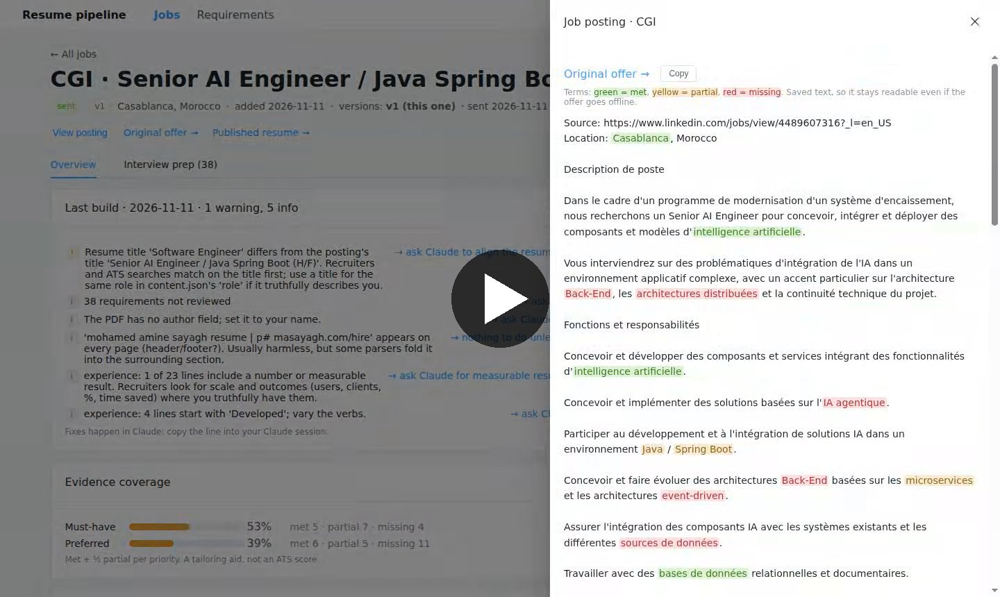

# Tailored Resume

[](https://cdn.lingowp.com/dashboard-tour.mp4)

## Features

**Your resume, tailored to every job**

**One master resume**
- Keep all your experience, skills and approved wording in one place
- Reuse your best lines from one application to the next
- Get your years of experience per skill, ready for application forms

**Start an application in seconds**
- Paste a job link and get the title, company, description and location
- See right away whether the job's location matches yours
- Create a new version of an application without touching the one you already sent

**Understand what the job asks for**
- Every requirement quoted word for word from the posting
- Must-haves kept apart from nice-to-haves

**Polished documents**
- A professional A4 resume with a QR code to your portfolio
- A one-page cover letter written for the job
- A French version when the posting is in French
- Files that aren't ready, such as a resume over 3 pages, are marked so you never send them by mistake

**Checks before you apply**
- Spelling check
- Writing style tips: stronger verbs, measurable results, shorter bullets
- A check that applicant tracking systems can read your PDF correctly
- A match against the job: what your resume proves, what it only claims, and what's missing, with the exact line as evidence
- A clear coverage figure for must-have and nice-to-have requirements

**Interview preparation**
- The stories to prepare behind your resume lines
- The claims to back up with a concrete example
- Honest answers ready for the gaps

**Share and send**
- Publish your resume and cover letter online, with one link per application
- Sent applications stay frozen, exactly as the employer received them

**Your job dashboard**
- Every application at a glance, with its status and coverage
- One page per job: gaps, requirements, documents, the posting and interview prep
- Preview your PDFs and re-read the posting with matched and missing terms highlighted
- See which requirements come up across all your applications, and which ones you miss most often

Generate a job-specific A4 resume PDF from a JSON content file, and review it against a job posting. The HTML template handles layout, page breaks, fonts, and a portfolio QR code.

[View the default PDF](template/build/resume.pdf)

## Requirements

- Python 3.10 or newer
- Google Chrome available as `google-chrome` in WSL or Linux

Create a local environment and install the Python dependency:

```bash
python3 -m venv .venv
.venv/bin/pip install -r requirements.txt
```

The QR generator is bundled in `src/vendor/`, so it needs no additional install.

## Layout

- `template/` — `layout/` (resume and cover-letter HTML, fonts, logos), `content/` (`default.json` / `default-fr.json`: the master resume, **generated** from `data/resume.db`), `build/` (baseline PDF).
- `data/` — `resume.db` (knowledge base: master resume, line library, skills, offers, default cover letter) and `resume.sql` (its committed text copy).
- `jobs/<company>-<title>-v<N>/` — one folder per application: the posting, the offer (`data/resume.db`) (requirements), `content.json` (tailored content, starts as a copy of `template/content/default.json`), the PDF (named `<Your-Name>-<Job-Title>-<Company>.pdf`, set by `pdf_name` in the offer (`data/resume.db`)), `cover.json` (cover letter text) with its two PDFs (`…-Cover-Letter.pdf` and `…-Resume-and-Cover-Letter.pdf`), and the generated `review.json`/`review.md`.
- `src/` — all the tools.

## Start a new job application

```bash
.venv/bin/python src/new_job.py --url <job posting link>      # reads title, company, posting, location
.venv/bin/python src/new_job.py                               # or paste the posting
```

`--url` reads the posting with `src/fetch_posting.py` (works with LinkedIn, Greenhouse, Lever, Teamtailor, Oracle careers, SAP SuccessFactors; try `src/fetch_posting.py <link>` alone to preview) and compares the job's location with yours. Without it, the script prompts for the company, the job title, and the posting text (paste it, then press Ctrl-D).

Version 1 workflow after the folder exists:

1. **Requirements are parsed when the job is created:** `src/parse_offer.py` (Haiku via the `claude` CLI) reads the company, title, location and every skill the posting asks for, with its type, priority (must-have 100 / preferred 0) and minimum years. A word already known as a keyword (same spelling, ignoring case, spaces, hyphens, dots and a final s) reuses its skill; anything new is saved as an unconfirmed skill to review. Check them, then the job is composed.
2. **Review** with `src/review_ats.py --job jobs/<slug>`: report, and `interview.json` (prep topics), labelled draft until requirements are reviewed. `--preview` prints the match and compares with the last saved report (verdict: no regression / REGRESSION).
3. **Tailor** `content.json` within the rules in `.claude/skills/ats-review/SKILL.md` (3 pages, 6 skill rows of 4, experience edits proposed and confirmed first), rebuild, publish. It refuses to run if `template/content/default.json` has any unresolved spelling/style/PDF-readability finding — fix the baseline first, since every new application starts from it. On success it creates `jobs/<slug>/`, builds the resume, and writes a partial report (no job-matching yet).

To check whether the baseline is ready without starting a new application:

```bash
.venv/bin/python src/check_template.py
```

Rebuilds `template/build/resume.pdf` and lists every spelling/style/PDF-readability finding (same checks `new_job.py` gates on). Prints "ready" and exits 0 if there are none.

## Publish a resume (optional)

```bash
.venv/bin/python src/publish_resume.py jobs/<slug>    # tailor.py runs it after every build
```

Publishing is set in `config.json` (copy `config.example.json`; `config.json` is ignored by git):

| `publish.mode` | Effect |
|---|---|
| `none` (default, no config needed) | Nothing is published; the PDFs stay in `jobs/<slug>/`. |
| `folder` | The English resume and cover letter are copied to a folder (any static host or sync tool can serve it). |
| `git` | They are committed to your portfolio repository through a dedicated clone and pushed to a branch. |

`path` sets where files go and `url` their public link (`{site}`, `{company}`, `{file}`). Sent jobs, not-ready (`_`) files and the French version are never published. An application has one public link: every version publishes to the same place, so the link always serves the latest version. Details: `.claude/skills/publish-resume/SKILL.md`.

## Build a resume

Build the baseline version:

```bash
.venv/bin/python src/build_resume.py
```

Build one application's tailored version:

```bash
.venv/bin/python src/build_resume.py jobs/company-role-v1/content.json
```

The PDF is saved next to the JSON file: in a job folder it uses the offer's `pdf_name`, otherwise `resume.pdf`. Use `-o path/to/resume.pdf` to choose another location. HTML is created temporarily during rendering and removed afterward.

## Cover letter

Every job build also produces the cover letter, so a job folder always holds three PDFs:

| File | Content |
| --- | --- |
| `<pdf_name>` | The resume |
| `<stem>-Cover-Letter.pdf` | The cover letter, one page |
| `<stem>-Resume-and-Cover-Letter.pdf` | The resume pages, then the cover letter page |

The letter text lives in `jobs/<slug>/content/cover.json`. The first build creates it from the default letter in `data/resume.db` (the newest approved paragraph of each part; greeting and closing in `profile`, else plain ones; with none yet, the letter waits until it is drafted), filling in the company and job title from the offer; an empty `date` prints the build date. To tailor it, ask Claude to write the cover letter for the job (or run `/draft-cover-letter`): it follows `.claude/skills/draft-cover-letter/SKILL.md`, edits `cover.json` and rebuilds. After editing `cover.json` by hand, rebuild only the letter:

```bash
.venv/bin/python src/build_cover.py jobs/company-role-v1
```

If the text runs past the page, the build warns and saves both cover PDFs with a leading `_` (not ready to send), like an over-length resume. When publishing is on (`config.json`), the English resume and its ready cover letter are published; the combined PDF and the French version stay local.

## Edit content

**The master resume lives in `data/resume.db`.** `template/content/default.json` (English) and `default-fr.json` (French) are generated from it by `src/master.py`; never edit them by hand (the next generation refuses and tells you, rather than losing your change). Each job's `content/content.json` starts as a copy of the generated master, then is tailored per job.

```bash
.venv/bin/python src/master.py set summary "<English>" "<French>"        # or: role
.venv/bin/python src/master.py set skill <row> <position> "<label>" ["<French label>"]
.venv/bin/python src/master.py set line <activity id> "<English>" ["<French>"]   # the master line of an activity
.venv/bin/python src/master.py set contact <field> "<value>"             # email, phone, website, website_link, ...
.venv/bin/python src/master.py check                                     # do the files match the db?
```

In `contact`, `website` is the displayed text and `website_link` is the clickable URL in the header, footer, and QR code.

## Check spelling

Run this before building. `src/check_spelling.py` reads a content JSON and lists every word the English dictionary does not know, with suggested fixes and the field to edit (for example `experience[2].bullets[1]`). Each result is a **warning**, not an error, because product names and tech terms are often correct even when the dictionary does not know them. Company names, skills, institutions and locations are trusted automatically. Add other words you have confirmed to `spelling-allow.txt`.

```bash
.venv/bin/pip install -r requirements-review.txt
.venv/bin/python src/check_spelling.py                              # template/content/default.json
.venv/bin/python src/check_spelling.py jobs/company-role-v1/content.json
```

The report is saved to `spelling.json` next to the content file.

## Check writing style

`src/check_style.py` reads a content JSON and gives rule-based advice for the recruiter who reads the resume after the ATS: first person ("I", "my"), weak openers ("Helped", "Contributed to"), bullets over 30 words, a summary over 60 words, how many lines include a number or measurable result, and verbs repeated at the start of 3 or more lines. Everything is a warning or info, never an error.

```bash
.venv/bin/python src/check_style.py                                 # template/content/default.json
```

The report is saved to `style.json` next to the content file.

## Check the PDF text

Applicant tracking systems (ATS) read your resume by extracting the PDF's text. `src/check_pdf.py` extracts that text the same way and compares it with the content JSON next to it. It flags:

- **Readability:** image-only pages, missing fields, headings and dates broken across lines, non-standard section names, jobs without a title, and job headers repeated on a continuation page.
- **Contact and links:** email and phone format (including a country code), LinkedIn/GitHub/website addresses that exist only as icons and not as text, and links that do not open. Add `--no-network` to skip opening the links.
- **Dates:** single dates instead of ranges, reversed or future dates, overlapping jobs, and your years of experience counted two ways (overlaps once, and every job added up, as some parsers do).
- **File:** PDF metadata (title with your name; author your name; subject naming the job; keywords; a creator that is not a browser string), and a file name without your name in it. The builds set all of it on the resume, the cover letter and the combined PDF, and `build_cover.py` checks the letter and combined PDF too.

```bash
.venv/bin/python src/check_pdf.py                       # template/build/resume.pdf + template/content/default.json
.venv/bin/python src/check_pdf.py jobs/company-role-v1/resume.pdf
.venv/bin/python -m unittest discover -s tests -t .  # self-test
```

The JSON report is saved to `pdf-check.json` next to the PDF. The command exits with code 1 on errors; warnings are advice. It checks text extraction only and is not a score from any employer's ATS.

## Describe a job posting

A job file (`jobs/<slug>`) lists what a posting asks for. Each requirement has the exact quote from the posting, a `must_have` or `preferred` priority, and the search terms in the posting's own wording. You mark each requirement as reviewed after checking it yourself. `src/check_job.py` validates the file: every quote must appear word for word in the posting, terms must come from the quote, nice-to-have lines cannot be marked `must_have`, and unreviewed requirements fail. The field rules are in `.claude/skills/ats-review/SKILL.md`; `tests/fixtures/fictional-job.json` is a complete example.

```bash
.venv/bin/python src/check_job.py tests/fixtures/fictional-job.json      # the example offer
.venv/bin/python src/check_job.py jobs/company-role-v1 --draft   # while still reviewing
```

## Review a resume for a job (one command)

`src/review_ats.py` runs all the checks for one posting and writes a readable report:

```bash
.venv/bin/python src/review_ats.py --job jobs/company-role-v1
```

The report, `review.md` next to the job file (with `review.json` beside it), contains these sections in order:

1. **Decisions for you:** must-haves that are not met, stale overrides, and PDF errors.
2. **PDF readability:** the `src/check_pdf.py` findings.
3. **Content checks:** spelling and style warnings.
4. **Must-have requirements, then preferred requirements:** gaps first, each with the posting quote, your PDF quote and page, the reason, and a rule-based suggestion such as "the posting says X; your PDF says Y".
5. **Summary:** the met/partial/missing/uncertain counts, and **evidence coverage**: Σ weight × (1 met, 0.5 partial) ÷ Σ weight, per priority, weighted by skill type (hard skills 1, education and language 0.5, soft and location 0.25; `TYPE_WEIGHTS` in `src/review_ats.py`). An **overall** figure covers every requirement, a preferred one weighted ¼ of a must-have (`PRIORITY_WEIGHTS`). Evidence coverage is not an ATS score or a hiring probability, and it is kept separate from PDF readability.

Without `--cv`/`--content`, the command uses the job's `pdf/` resume and `content/content.json`. To correct a result, add an override to the offer's requirement (`override_status`, `override_reason`, `override_quote` in `data/resume.db`); the report keeps the automated finding next to it.

## Match your resume to a job

`src/match_job.py` checks a validated job file against the resume PDF text. For each requirement it reports two separate things:

- **Keyword:** whether the posting's exact term appears anywhere in the PDF, which is what a recruiter's search sees. The result is `exact`, `alias` (wording differs: use the posting's term), or `absent`.
- **Evidence:** whether the resume backs the requirement up. `met` means it was found in experience, education, languages or header text. `partial` means it was found only in the skills list or summary (a claim, not proof), or only some of the requirement's terms were met. `missing` means there is no supporting text in this PDF; it does not mean you lack the skill. `uncertain` means the text cannot support a decision.

Every `met` or `partial` result quotes the exact PDF line and its page. "At least N years" requirements are computed from your job dates. Matching is deterministic: no model and no network. Alternative spellings that count as the same term (for example Postgres for PostgreSQL) are skill keywords in `data/resume.db`; add one with `src/skills_inventory.py keyword "PostgreSQL" "Postgres"`, true synonyms only.

```bash
.venv/bin/python src/match_job.py jobs/company-role-v1
```

The report is saved to `match.json` next to the job file.

## Job dashboard

A local web app to browse the job folders: every application with its status and coverage, one page per job (requirements, gaps, PDFs, posting, interview prep), and every posting term across jobs.

```bash
python3 start.py   # then open http://127.0.0.1:8000
```

[Watch a 30-second tour](https://cdn.lingowp.com/dashboard-tour.mp4)

It reads `data/resume.db` (read-only) and the job folders. Its only write action is **New version**, which runs `src/new_job.py --from`. Open points are listed in [`dashboard/notice.md`](dashboard/notice.md).

## For AI assistants

The ATS reviewer's usage rules for AI tools are in [`.claude/skills/ats-review/SKILL.md`](.claude/skills/ats-review/SKILL.md). Claude Code loads that file automatically as a skill. Other tools reach it through [`AGENTS.md`](AGENTS.md).

## Project files

| Path | Purpose |
| --- | --- |
| `template/content/default.json` | Master resume content |
| `template/layout/resume.html`, `template/layout/fonts/`, `template/layout/assets/` | Page layout, print styles, bundled Poppins fonts (OFL license) and SVG logos |
| `template/build/resume.pdf` | Baseline build |
| `template/layout/cover-letter.html` | Cover letter layout (the default text is in `data/resume.db`) |
| `jobs/<slug>/` | One folder per application: posting, job requirements, tailored content, built PDF, and report |
| `src/build_resume.py` | Validates content, creates the QR, checks page fit, and exports the PDF; for a job folder, then runs `build_cover.py` |
| `src/build_cover.py` | Builds a job's cover letter PDF and the combined resume + cover letter PDF from `cover.json` |
| `src/new_job.py` | Scaffolds a new `jobs/<slug>/` folder from a pasted posting |
| `src/check_template.py` | Checks whether `template/` is ready (no spelling/style/PDF findings) to start a new application |
| `src/check_spelling.py`, `check_style.py`, `check_pdf.py`, `check_job.py`, `match_job.py`, `review_ats.py` | ATS reviewer tools |
| `data/resume.db`, `data/resume.sql` | Knowledge base (experiences, approved lines, skills and keywords, offers); the `.sql` file is the committed copy, `src/db.py restore` rebuilds the db |
| `spelling-allow.txt` | Confirmed spellings |
| `src/vendor/` | Bundled QR generator and its license |
| `dashboard/`, `start.py` | Local job dashboard: FastAPI back (`dashboard/app.py`), Vue + Element Plus front (`dashboard/web/`) |
| `tests/` | Tests for the reviewer (`.venv/bin/python -m unittest discover -s tests -t .`) |
| `.claude/skills/ats-review/`, `.claude/skills/draft-cover-letter/`, `.claude/skills/publish-resume/`, `AGENTS.md` | Instructions for AI assistants |

